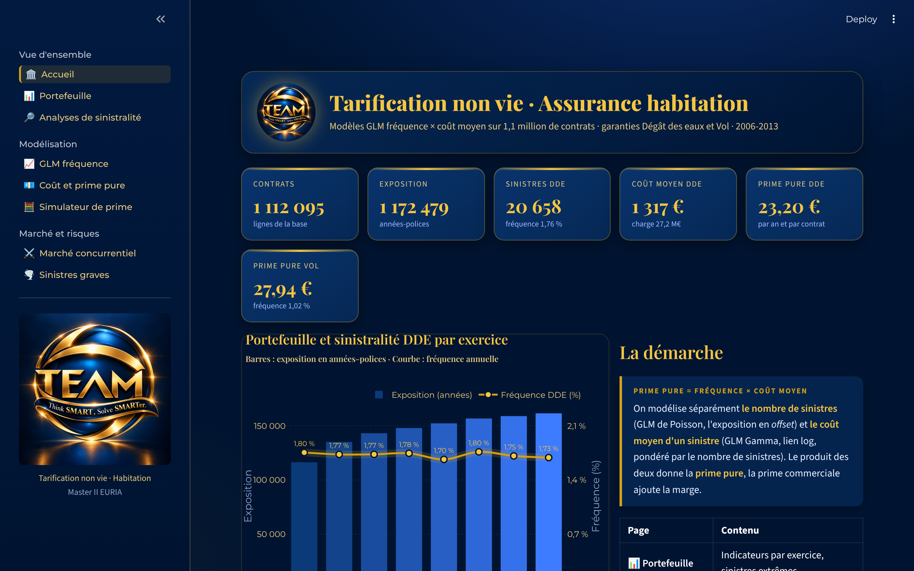
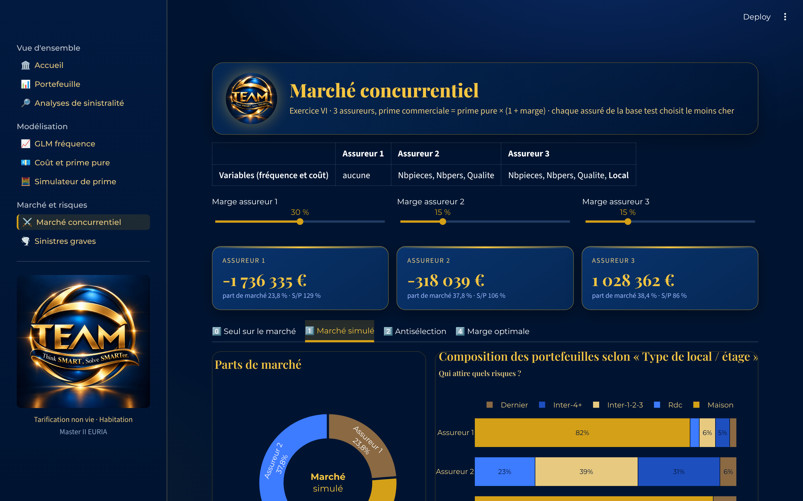
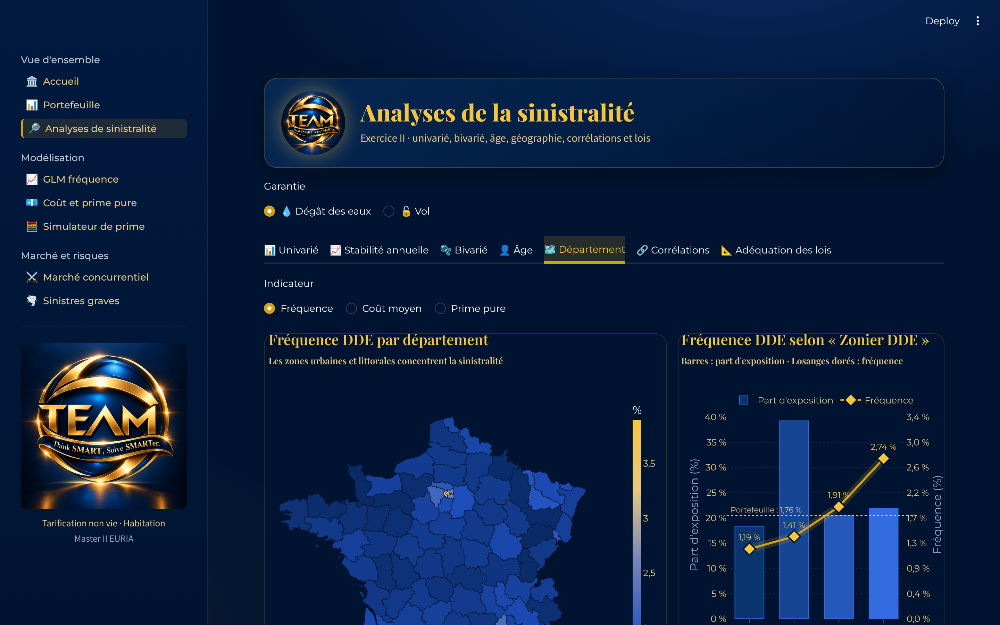
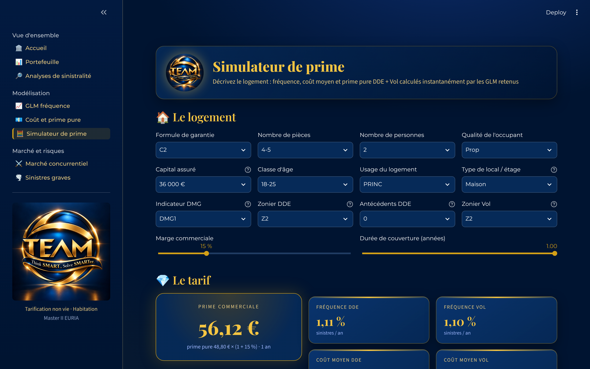

<p align="center">
  
</p>

<h1 align="center">Tarification non vie avec Python</h1>
<p align="center"><b>Assurance habitation · garanties Dégât des eaux et Vol · GLM fréquence × coût moyen · dashboard Streamlit</b><br>
<i>Master II EURIA · Think SMART, Solve SMARTer.</i></p>

<p align="center">
  <a href="#déploiement"></a>
  
  
</p>

---

## Aperçu

| Accueil | Marché concurrentiel |
|---|---|
|  |  |
| **Carte de la sinistralité** | **Simulateur de prime** |
|  |  |

## Le projet

Réalisation complète du TD *Tarification non vie sur Python* (exercices I à VII) sur une base de **1 112 095 contrats
habitation** (2006-2013), puis mise en production d'un **dashboard interactif** et d'un **simulateur de prime**.

| Étape | Contenu | Où |
|---|---|---|
| Ex I | Volumes, exposition, fréquence, coût moyen, sinistres extrêmes | `notebooks/01_exploration.ipynb` |
| Ex II | Stabilité, univarié, bivarié, âge, département, V de Cramer, adéquation des lois | `notebooks/01_exploration.ipynb` |
| Ex III | GLM Poisson (offset log-exposition), AIC / BIC / RMSE test, anomalies du modèle complet | `notebooks/02_glm_frequence.ipynb` |
| Ex IV | Importance par retrait, interactions, sélection backward vs forward | `notebooks/02_glm_frequence.ipynb` |
| Ex V | GLM Gamma sur le coût moyen, prime pure, lift, Lorenz / Gini | `notebooks/03_cout_prime_pure.ipynb` |
| Ex VI | Marché concurrentiel à 3 assureurs, antisélection, marge optimale | `notebooks/04_marche.ipynb` |
| Ex VII | Sinistres graves en Vol, écrêtement, mutualisation, effet en marché | `notebooks/05_sinistres_graves.ipynb` |

## Résultats clés

- **Portefeuille DDE** : 20 658 sinistres pour 27,2 M€, fréquence **1,76 %**, coût moyen **1 317 €**,
  prime pure observée **23,20 €** par an. Fréquence et coût moyen stables par exercice.
- **GLM fréquence** : le GLM nul retrouve exactement la fréquence moyenne. Backward et forward retiennent
  **le même modèle à 11 variables** (seul `Direct` est écarté). Variables les plus discriminantes : zonier DDE,
  type de local, nombre de pièces, qualité de l'occupant. Anomalie corrigée : relativité du capital assuré non
  monotone, d'où un regroupement (48-64 000 € et ≥ 128 000 €) qui améliore AIC et BIC.
- **GLM coût** : seules `Nbpieces`, `Local`, `Qualite` et `Usage` sont significatives. Le tarif final prédit
  la charge test à **0,02 %** près, avec un **Gini de 0,325** (contre 0,235 pour un modèle à 3 variables).
- **Marché concurrentiel** : l'assureur le plus segmenté (assureur 3) est le seul bénéficiaire
  (**+1,03 M€**, S/P 86 %) : il capte les maisons, moins risquées à profil égal, que l'assureur 2 surtarife ; les assureurs 1 et 2 subissent l'antisélection (S/P 129 % et 106 %).
  Marge optimale de l'assureur 3 : **19 %** au pourcent près (≈ 1,28 M€).
- **Sinistres graves** : seuil d'écrêtement Vol à 20 000 € (rupture du *mean excess plot*, ≈ quantile 99,5 %),
  charge au-delà mutualisée par une surcharge. Sans retraitement, le grave pilote la segmentation et
  l'assureur perd en concurrence.

## Choix méthodologiques et écarts avec le corrigé

Le projet suit **l'énoncé du TD** lorsqu'il diffère des corrections, et le documente :

1. **Découpage** : `np.random.seed(2016); np.random.choice(len(bd), 300000, replace=False)` comme l'énoncé.
   Le notebook du cours utilise `bd.sample(random_state=2016)`, qui ne tire pas les mêmes lignes.
2. **Pondération du GLM Gamma** : `var_weights = nombre de sinistres` partout (comme l'Ex V du corrigé).
   L'Ex VI du corrigé utilise `freq_weights`, qui donne les mêmes coefficients mais des écarts-types faux.
3. **Ex VII** : seed **2021** comme l'énoncé (le corrigé réutilise l'échantillon 2016). Avec 2021, aucun des
   deux graves n'est en apprentissage ; avec 2016, celui de 2 M€ l'est. Les deux cas sont analysés.
4. **Compléments** : la sélection backward / forward (IV.3) et le retraitement des graves (VII.2), absents des
   corrections, sont implémentés.
5. **Marge optimale** : recherche sur grille (au pourcent puis affinée) car le résultat est une fonction en escalier ;
   `minimize_scalar` peut s'arrêter sur un optimum local.
6. **Modèles finaux sans interaction** : tarif multiplicatif, lisible et stable.

## Structure

```
projet_tarification_streamlit/
├── app/
│   ├── streamlit_app.py      # point d'entrée (navigation)
│   ├── commun.py             # chargement, cache, composants visuels
│   └── vues/                 # 8 pages du dashboard
├── src/
│   ├── data.py               # chargement, typage, découpage, injection des graves
│   ├── indicateurs.py        # fréquence, CM, prime pure, V de Cramer
│   ├── modeles.py            # GLM, critères, sélection, lift, Gini, export du tarif
│   ├── marche.py             # marché concurrentiel, marge optimale
│   ├── graves.py             # mean excess, écrêtement, surcharge
│   ├── graphiques.py         # tous les graphiques Plotly (notebooks + app)
│   └── theme.py              # charte bleu nuit / or du logo
├── notebooks/                # exercices I à VII exécutés et commentés
├── scripts/entrainer_modeles.py   # entraîne et sauvegarde les modèles (≈ 10 min)
├── models/                   # tarif.json + résultats pré-calculés (parquet)
├── data/base_tarif.rds
└── assets/                   # logo, CSS, contours des départements
```

## Lancer en local

```bash
python -m venv .venv
.venv\Scripts\activate            # Windows (source .venv/bin/activate sous Linux / macOS)
pip install -r requirements-dev.txt
python -m scripts.entrainer_modeles     # facultatif : models/ est déjà fourni
streamlit run app/streamlit_app.py
```

## Déploiement

L'application est prévue pour **Streamlit Community Cloud** (gratuit) :

1. Pousser ce dossier sur un dépôt GitHub.
2. Sur [share.streamlit.io](https://share.streamlit.io), se connecter avec GitHub puis **Create app**.
3. Choisir le dépôt, la branche `main` et le fichier principal **`app/streamlit_app.py`** ; dans *Advanced settings*,
   choisir Python 3.12 ou 3.13.
4. **Deploy** : l'application est en ligne en quelques minutes.

Les modèles sont pré-entraînés (`models/`) : l'application ne réestime que de petits GLM à la volée et tient dans
la mémoire de l'offre gratuite.

---
<p align="center"><sub>Graphiques : Plotly, charte extraite du logo (bleu nuit #001431, bleu royal #1E4FBF, or #D4A017 / #F5C542).
Contours des départements : <a href="https://github.com/gregoiredavid/france-geojson">france-geojson</a>.</sub></p>
